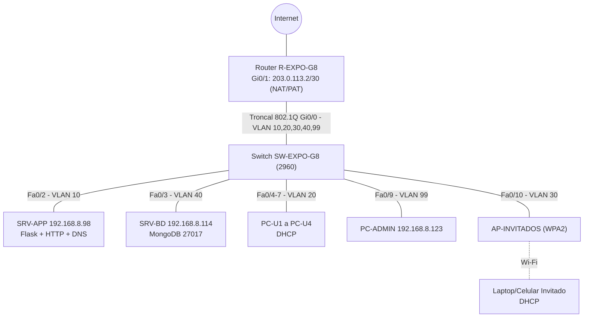

[REDES.md](https://github.com/user-attachments/files/34720791/REDES.md)
# REDES.md – Grupo 8 (Maidana – Melnik) · Trivia

> Proyecto Integrador Final – ExpoTécnica 2026 · E.P.E.T. Nº1 UNESCO
> Materias: Programación II + Bases de Datos II + Seguridad Informática + Redes Informáticas

---

## 1. Organización y escenario

**Organización elegida:** Sala de Informática de la E.P.E.T. Nº1 UNESCO.

La escuela pone en funcionamiento la **Trivia** como herramienta de repaso para estudiantes. Los alumnos juegan desde las PCs de la sala (red cableada) y los visitantes o celulares usan un Wi-Fi de invitados que **no** tiene acceso a los servidores.

### Qué hace la aplicación (y por qué importa para la red)

| Componente | Tecnología | Puerto | Ubicación en la red |
|---|---|---|---|
| Aplicación web (Flask) | Python + Flask, HTML/CSS/JS | 5000 (interno) / 80 (publicado) | Servidor de aplicación, VLAN 10 |
| Base de datos | MongoDB (colecciones `preguntas` y `puntuaciones`) | 27017 | Servidor de BD, VLAN 40 |
| Nombre de la app | DNS interno | UDP 53 | `app.expotecnica.local` → `192.168.8.98` |

**Flujo de tráfico de una partida:**

1. El navegador del jugador (VLAN 20) pide `http://app.expotecnica.local` → consulta DNS (UDP 53) y luego HTTP (TCP 80) al servidor de aplicación.
2. El navegador llama a `/api/quiz/iniciar` y `/api/quiz/responder`. Flask valida las respuestas **en el servidor**; el jugador nunca recibe la respuesta correcta.
3. Flask consulta y guarda en MongoDB por TCP 27017 (servidor de aplicación → servidor de BD). Es la **única** conexión permitida hacia la base de datos.

> En producción Flask corre en el puerto 5000 detrás de un proxy inverso (nginx) que lo publica en el puerto 80. Las ACL permiten solo el 80. En Packet Tracer se simula con el servicio HTTP del servidor, que escucha en el 80.

---

## 2. Diagrama de topología




> `TODO`: agregar acá la captura del diagrama hecho en Packet Tracer (`docs/img/topologia.png`).

**Equipos mínimos pedidos:** 1 router, 1 switch, 1 punto de acceso, servidor de aplicación, servidor de BD y 4 PCs de usuarios ✔.

---

## 3. Plan de direccionamiento (VLSM sobre 192.168.8.0/24)

**Bloque asignado:** `192.168.8.0/24` (Grupo 8).

### Cantidad de hosts necesaria y prefijo elegido

| VLAN | Hosts a cubrir (con crecimiento) | Prefijo mínimo |
|---|---|---|
| 30 – Invitados | ~50 (celulares y laptops de visitantes) | /26 (62 útiles) |
| 20 – Usuarios | ~25 (PCs de la sala) | /27 (30 útiles) |
| 10 – Servidores | 2 servidores + equipos futuros | /28 (14 útiles) |
| 40 – BaseDatos | 1 servidor + gateway + reserva | /29 (6 útiles) |
| 99 – Administración | switch + PC admin + gateway | /29 (6 útiles) |

Se asigna de **mayor a menor** (regla de VLSM) para no desperdiciar direcciones ni solapar bloques.

### Tabla de direccionamiento

| VLAN (ID y nombre) | Red / Prefijo | Máscara | Rango de hosts | Gateway | Hosts útiles | Asignación |
|---|---|---|---|---|---|---|
| 30 – Invitados | 192.168.8.0/26 | 255.255.255.192 | 192.168.8.1 – .62 | 192.168.8.1 | 62 | DHCP |
| 20 – Usuarios | 192.168.8.64/27 | 255.255.255.224 | 192.168.8.65 – .94 | 192.168.8.65 | 30 | DHCP |
| 10 – Servidores | 192.168.8.96/28 | 255.255.255.240 | 192.168.8.97 – .110 | 192.168.8.97 | 14 | IP fija |
| 40 – BaseDatos | 192.168.8.112/29 | 255.255.255.248 | 192.168.8.113 – .118 | 192.168.8.113 | 6 | IP fija |
| 99 – Administración | 192.168.8.120/29 | 255.255.255.248 | 192.168.8.121 – .126 | 192.168.8.121 | 6 | IP fija |

Broadcasts: .63, .95, .111, .119 y .127. **Libre para crecimiento / segunda sede:** `192.168.8.128/25`.

### IPs fijas

| Equipo | VLAN | IP | Máscara | Gateway |
|---|---|---|---|---|
| SRV-APP (Flask + HTTP + DNS) | 10 | 192.168.8.98 | 255.255.255.240 | 192.168.8.97 |
| SRV-BD (MongoDB) | 40 | 192.168.8.114 | 255.255.255.248 | 192.168.8.113 |
| SW-EXPO-G8 (SVI VLAN 99) | 99 | 192.168.8.122 | 255.255.255.248 | 192.168.8.121 |
| PC-ADMIN | 99 | 192.168.8.123 | 255.255.255.248 | 192.168.8.121 |
| Router (subinterfaces) | – | .1 / .65 / .97 / .113 / .121 | según VLAN | – |

### Justificación de las decisiones

- **Base de datos en una VLAN propia (40):** si la app y MongoDB estuvieran en la misma VLAN, el tráfico entre ellos se conmutaría en el switch y el router no podría filtrarlo. Separándolas, la ACL del router garantiza que el puerto 27017 solo sea alcanzable desde el servidor de aplicación.
- **VLAN 99 de administración:** el SSH al switch y al router se hace desde una red separada de usuarios e invitados. Además se usa como VLAN nativa del troncal.
- **DHCP solo en Usuarios e Invitados:** los servidores tienen IP fija para que el DNS y las ACL apunten siempre a la misma dirección.
- **Invitados con /26:** es la red con más dispositivos, y el Wi-Fi suele crecer más rápido que el cableado.

---

## 4. Configuración (fragmentos clave, sin contraseñas reales)

### 4.1 Router (R-EXPO-G8, modelo 2911)

```
hostname R-EXPO-G8
no ip domain-lookup
ip domain-name expotecnica.local
enable secret <CLAVE_ENABLE>
service password-encryption
username admin secret <CLAVE_ADMIN>
banner motd # ACCESO RESTRINGIDO: solo personal autorizado. Toda actividad es registrada. #

! --- SSH (no Telnet) ---
crypto key generate rsa modulus 2048
ip ssh version 2
line vty 0 4
 login local
 transport input ssh
line console 0
 password <CLAVE_CONSOLA>
 login

! --- Router-on-a-stick ---
interface GigabitEthernet0/0
 no shutdown
interface GigabitEthernet0/0.10
 description SERVIDORES
 encapsulation dot1Q 10
 ip address 192.168.8.97 255.255.255.240
interface GigabitEthernet0/0.20
 description USUARIOS
 encapsulation dot1Q 20
 ip address 192.168.8.65 255.255.255.224
 ip access-group USUARIOS_IN in
interface GigabitEthernet0/0.30
 description INVITADOS
 encapsulation dot1Q 30
 ip address 192.168.8.1 255.255.255.192
 ip access-group INVITADOS_IN in
interface GigabitEthernet0/0.40
 description BASEDATOS
 encapsulation dot1Q 40
 ip address 192.168.8.113 255.255.255.248
 ip access-group BD_OUT out
interface GigabitEthernet0/0.99
 description ADMINISTRACION
 encapsulation dot1Q 99 native
 ip address 192.168.8.121 255.255.255.248
```

### 4.2 DHCP (en el router)

```
ip dhcp excluded-address 192.168.8.1 192.168.8.10
ip dhcp excluded-address 192.168.8.65 192.168.8.69
! Los servidores (192.168.8.96/28 y 192.168.8.112/29) no tienen pool: son IP fija.

ip dhcp pool USUARIOS
 network 192.168.8.64 255.255.255.224
 default-router 192.168.8.65
 dns-server 192.168.8.98
 domain-name expotecnica.local
ip dhcp pool INVITADOS
 network 192.168.8.0 255.255.255.192
 default-router 192.168.8.1
 dns-server 8.8.8.8
```

Los invitados usan un DNS público porque no pueden consultar al servidor interno.

### 4.3 Switch (SW-EXPO-G8, modelo 2960)

```
hostname SW-EXPO-G8
no ip domain-lookup
ip domain-name expotecnica.local
enable secret <CLAVE_ENABLE>
service password-encryption
username admin secret <CLAVE_ADMIN>
banner motd # ACCESO RESTRINGIDO: solo personal autorizado. #
crypto key generate rsa modulus 2048
ip ssh version 2
line vty 0 15
 login local
 transport input ssh

vlan 10
 name SERVIDORES
vlan 20
 name USUARIOS
vlan 30
 name INVITADOS
vlan 40
 name BASEDATOS
vlan 99
 name ADMIN

interface FastEthernet0/1
 description TRONCAL-HACIA-ROUTER
 switchport mode trunk
 switchport trunk native vlan 99
 switchport trunk allowed vlan 10,20,30,40,99
interface FastEthernet0/2
 description SRV-APP
 switchport mode access
 switchport access vlan 10
interface FastEthernet0/3
 description SRV-BD
 switchport mode access
 switchport access vlan 40
interface range FastEthernet0/4 - 7
 description PCS-USUARIOS
 switchport mode access
 switchport access vlan 20
interface FastEthernet0/9
 description PC-ADMIN
 switchport mode access
 switchport access vlan 99
interface FastEthernet0/10
 description AP-INVITADOS
 switchport mode access
 switchport access vlan 30

interface Vlan99
 ip address 192.168.8.122 255.255.255.248
 no shutdown
ip default-gateway 192.168.8.121

! Puertos sin uso apagados
interface range FastEthernet0/8 , FastEthernet0/11 - 24 , GigabitEthernet0/1 - 2
 shutdown
```

### 4.4 Servicios en Packet Tracer

| Servidor | Servicio | Configuración |
|---|---|---|
| SRV-APP | DNS (ON) | Registro A: `app.expotecnica.local` → `192.168.8.98` |
| SRV-APP | HTTP (ON) | Edit de `index.html` con el texto "Trivia – Grupo 8" |
| SRV-BD | – | Solo IP fija. MongoDB se representa con la ACL y la prueba de puerto 27017 |

### 4.5 ACL

```
! Invitados: sin acceso a Servidores, BD, Admin ni Usuarios; Internet permitido
ip access-list extended INVITADOS_IN
 deny ip 192.168.8.0 0.0.0.63 192.168.8.96 0.0.0.15
 deny ip 192.168.8.0 0.0.0.63 192.168.8.112 0.0.0.7
 deny ip 192.168.8.0 0.0.0.63 192.168.8.120 0.0.0.7
 deny ip 192.168.8.0 0.0.0.63 192.168.8.64 0.0.0.31
 permit ip any any

! Usuarios: al servidor de la app solo DNS, HTTP (80) y ping; el resto de la red interna bloqueado
ip access-list extended USUARIOS_IN
 permit udp 192.168.8.64 0.0.0.31 host 192.168.8.98 eq domain
 permit tcp 192.168.8.64 0.0.0.31 host 192.168.8.98 eq www
 permit icmp 192.168.8.64 0.0.0.31 host 192.168.8.98 echo
 deny ip 192.168.8.64 0.0.0.31 192.168.8.96 0.0.0.15
 deny ip 192.168.8.64 0.0.0.31 192.168.8.112 0.0.0.7
 deny ip 192.168.8.64 0.0.0.31 192.168.8.120 0.0.0.7
 deny ip 192.168.8.64 0.0.0.31 192.168.8.0 0.0.0.63
 permit ip any any

! MongoDB: hacia la VLAN de BD solo entra la app por 27017 (y SSH del admin)
ip access-list extended BD_OUT
 permit tcp host 192.168.8.98 host 192.168.8.114 eq 27017
 permit icmp host 192.168.8.98 host 192.168.8.114 echo
 permit tcp 192.168.8.120 0.0.0.7 host 192.168.8.114 eq 22
 deny ip any any
```

El orden de las líneas importa: Packet Tracer evalúa de arriba hacia abajo y corta en la primera coincidencia.

### 4.6 Opcionales

```
! NAT/PAT (Gi0/1 = salida a Internet simulada)
interface GigabitEthernet0/1
 ip address 203.0.113.2 255.255.255.252
 ip nat outside
 no shutdown
interface range GigabitEthernet0/0.10 , GigabitEthernet0/0.20 , GigabitEthernet0/0.30 , GigabitEthernet0/0.40 , GigabitEthernet0/0.99
 ip nat inside
access-list 1 permit 192.168.8.0 0.0.0.255
ip nat inside source list 1 interface GigabitEthernet0/1 overload
ip route 0.0.0.0 0.0.0.0 203.0.113.1
```

```
! Port Security en los puertos de PCs de usuarios (switch)
interface range FastEthernet0/4 - 7
 switchport port-security
 switchport port-security maximum 2
 switchport port-security mac-address sticky
 switchport port-security violation restrict
```

**Wi-Fi WPA2:** en el AP-INVITADOS, pestaña *Config → Port 1 (Wireless)*: SSID `TRIVIA-INVITADOS`, autenticación WPA2-PSK, clave `<CLAVE_WIFI>`.

---

## 5. Registro de pruebas

| # | Prueba | Resultado esperado | Resultado real | Captura |
|---|---|---|---|---|
| 1 | `ipconfig` en PC-U1 | Recibe IP por DHCP en 192.168.8.64/27 (desde .70) | TODO | TODO |
| 2 | `ipconfig` en laptop Invitado | Recibe IP por DHCP en 192.168.8.0/26 | TODO | TODO |
| 3 | PC-U1 → `ping 192.168.8.98` (app) | ✔ Exitoso | TODO | TODO |
| 4 | PC-U1 → navegador `http://app.expotecnica.local` | ✔ Carga la página (DNS + HTTP) | TODO | TODO |
| 5 | PC-U1 → `tracert 192.168.8.98` | ✔ Salto 1: 192.168.8.65, salto 2: 192.168.8.98 | TODO | TODO |
| 6 | PC-U1 → `ping 192.168.8.114` (BD) | ✘ Bloqueado por ACL | TODO | TODO |
| 7 | Invitado → `ping 192.168.8.98` | ✘ Bloqueado por ACL | TODO | TODO |
| 8 | Invitado → `ping` a Internet simulada | ✔ Exitoso (si hay NAT) | TODO | TODO |
| 9 | SRV-APP → `ping 192.168.8.114` | ✔ Exitoso | TODO | TODO |
| 10 | SRV-APP → TCP 27017 a la BD (*Complex PDU*) | ✔ Permitido | TODO | TODO |
| 11 | PC-U1 → TCP 27017 a la BD (*Complex PDU*) | ✘ Bloqueado | TODO | TODO |
| 12 | `show access-lists` en el router | Contadores (matches) en las líneas `deny` y `permit` usadas | TODO | TODO |
| 13 | PC-ADMIN → `ssh -l admin 192.168.8.121` | ✔ Entra por SSH | TODO | TODO |
| 14 | PC-ADMIN → `telnet 192.168.8.121` | ✘ Rechazado | TODO | TODO |

> Packet Tracer no deja generar tráfico a puertos arbitrarios desde una PC con el comando `ping`. Para las pruebas 10 y 11 usá la herramienta **Add Complex PDU** (sobre de la barra lateral), protocolo TCP, puerto destino 27017, y mirá el resultado en el modo *Simulation* y en los contadores de `show access-lists`.

---

## 6. Bitácora de resolución de problemas

> Requisito: al menos 2 fallas **reales** encontradas durante el proyecto. Las de abajo son las fallas más comunes en este tipo de diseño. **Dejá solo las que realmente les pasaron** (o reemplazalas por las suyas) y completá la fecha.

| # | Fecha | Falla | Causa | Solución |
|---|---|---|---|---|
| 1 | TODO | Las PCs de Usuarios no obtenían IP por DHCP | La interfaz `Gi0/0` del router estaba en `shutdown` y el troncal del switch no permitía la VLAN 20 | `no shutdown` en `Gi0/0` y `switchport trunk allowed vlan 10,20,30,40,99` en `Fa0/1` |
| 2 | TODO | Las PCs de Usuarios entraban por IP pero no por `app.expotecnica.local` | La ACL `USUARIOS_IN` no permitía UDP 53 hacia el servidor DNS | Se agregó `permit udp ... host 192.168.8.98 eq domain` antes de los `deny` |
| 3 | TODO | La ACL no bloqueaba a Invitados | La línea `permit ip any any` estaba antes de los `deny` | Se rehizo la ACL con el orden correcto y se reaplicó en la subinterfaz |

---

## 7. Integración Redes + Seguridad

> Adaptá la columna "Amenaza" a los nombres exactos de tu `SECURITY.md`.

| Medida de red | Amenaza que mitiga (de SECURITY.md) | Cómo se verificó |
|---|---|---|
| ACL `INVITADOS_IN` que bloquea Invitados → Servidores/BD | Acceso no autorizado al servidor desde la red de invitados | Ping desde PC/laptop de Invitados al servidor: bloqueado (prueba 7) |
| ACL `BD_OUT`: solo la app llega a MongoDB (27017) | Acceso directo a la base de datos, robo o alteración de puntuaciones y preguntas | PDU TCP 27017 desde Usuarios bloqueado; desde SRV-APP permitido (pruebas 10 y 11) |
| ACL `USUARIOS_IN`: solo DNS, HTTP y ping al servidor de la app | Escaneo de puertos y movimiento lateral desde las PCs | Ping de PC-U1 al servidor de BD: bloqueado (prueba 6) |
| Segmentación en VLANs (10, 20, 30, 40, 99) | Propagación de un equipo comprometido y sniffing entre segmentos | Cada equipo recibe IP de su propio rango; sin ACL permisiva no hay ruta entre VLANs |
| SSH v2 + `enable secret` + `service password-encryption` + banner | Acceso remoto con credenciales en texto plano / acceso no autorizado a los equipos | `telnet` rechazado, `ssh` funciona (pruebas 13 y 14); `show running-config` sin claves legibles |
| VLAN 99 de administración | Administración de equipos desde redes no confiables | SSH solo exitoso desde PC-ADMIN |
| Port Security (opcional) | Conexión de equipos no autorizados a la sala | `show port-security interface fa0/4` |
| WPA2 en el Wi-Fi de invitados (opcional) | Acceso abierto a la red inalámbrica | La laptop solo se asocia al AP con la clave |
| NAT/PAT (opcional) | Exposición de direcciones internas hacia Internet | `show ip nat translations` |

### Medidas a nivel de aplicación y host (para coordinar con Seguridad)

- **Clave de sesión de Flask:** en `app.py` el valor por defecto de `FLASK_SECRET_KEY` es una clave local de desarrollo. En el servidor real hay que definir una variable de entorno con una clave larga y aleatoria.
- **MongoDB:** habilitar autenticación y limitar `bindIp` a `192.168.8.114`. Usar `MONGODB_URI` con usuario y clave, que se configura por variable de entorno sin tocar el código.
- **Firewall del host:** `ufw allow from 192.168.8.98 to any port 27017` en el servidor de BD (defensa en profundidad además de la ACL).
- **Modo debug apagado:** el código ya lo deja en `false` por defecto (`FLASK_DEBUG`).

---

## 8. Demostración en vivo (guion para la ExpoTécnica)

1. **Prueba exitosa:** desde PC-U1 abrir `http://app.expotecnica.local` y mostrar `tracert` hasta el servidor de la app.
2. **Prueba bloqueada:** desde la laptop de Invitados hacer `ping 192.168.8.98` → bloqueado. Mostrar luego `show access-lists` con los contadores subiendo.
3. **Bonus:** PC-U1 → `ping 192.168.8.114` bloqueado y SRV-APP → BD permitido.

---

## 9. Trello

Registrar en el tablero las tareas de Redes: diseño y VLSM, REDES.md, armado en Packet Tracer, DHCP/DNS, ACL, pruebas con capturas, bitácora y tabla de integración.

---

## 10. Archivos de entrega

- `REDES.md` (este archivo)
- `redes/trivia-grupo8.pkt` (simulación de Packet Tracer)
- `docs/img/` (capturas de topología y pruebas)
